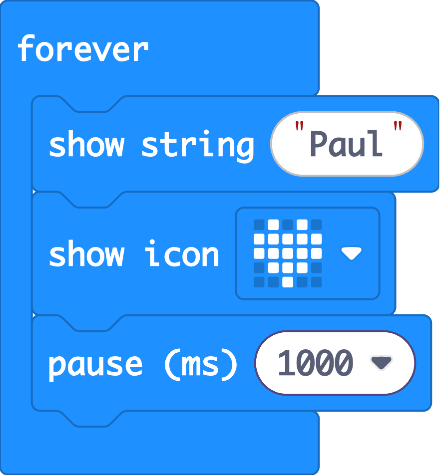

# Your First Program: Name Badge

Time to write some real code! You're going to turn your micro:bit into a name badge.

## The blocks you need

All of these are in the **Basic** (blue) section of the toolbox:

| Block | What it does |
|-------|--------------|
| **on start** | Runs the code inside it **once**, when the micro:bit switches on |
| **forever** | Runs the code inside it **over and over**, forever |
| **show string** | Scrolls text across the LEDs |
| **show icon** | Shows a picture (heart, smiley, etc.) |
| **pause (ms)** | Waits. 1000 ms = 1 second |

## Build it

1. Drag a **show string** block into the **forever** block and type your name.
2. Underneath it, add a **show icon** block and pick an icon you like.
3. Add a **pause** block and set it to **1000** ms.
4. Watch the virtual micro:bit on the left. Your name should scroll, then your icon should appear, over and over.
5. Click **Download** and copy it onto your real micro:bit.

Your finished code should look like this:

## Extra challenges

- Use **show leds** to draw your own picture, pixel by pixel.
- Show your age with **show number**.
- What happens if you move your code from **forever** into **on start**? Why?

Answer

**on start** only runs **once**, so your name scrolls a single time and then stops. **forever** keeps repeating it.

