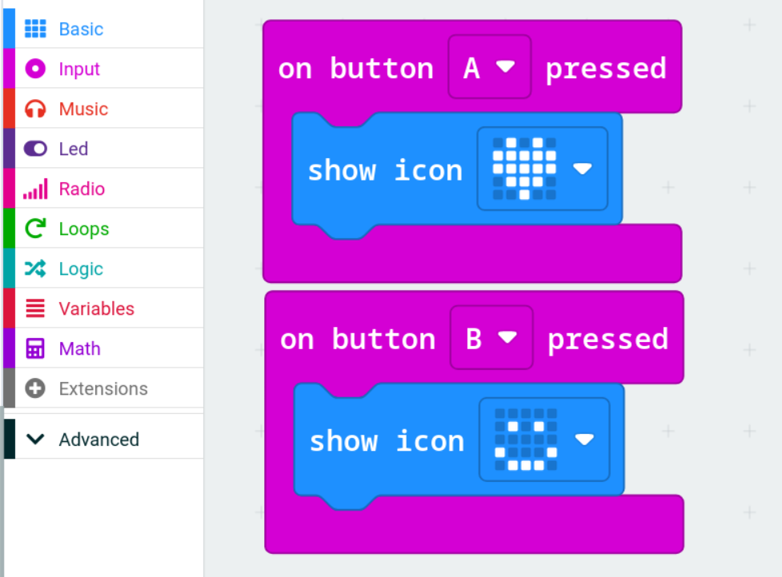

# Events & the LED Screen

Making the micro:bit react

## What is an event?

An **event** is something that happens: a button gets pressed, the micro:bit gets shaken, a radio message arrives.

An **on event block** waits for that thing to happen and then runs the code inside it. Until the event happens, the code inside does nothing.

You use events in real life all the time:
- **When** the alarm goes off **→** get up
- **When** the bell rings **→** go to your next class
- **When** your phone buzzes **→** check it

## Event blocks in MakeCode

Event blocks are the ones with no notch on top. They don't need to be inside anything else. Most are in the **Input** (pink) section:

| Block | Runs when... |
|-------|--------------|
| **on button A pressed** | Button A is pressed (you can change it to B or A+B) |
| **on shake** | The micro:bit is shaken (click the dropdown for tilt left, logo up, free fall and more) |
| **on logo pressed** | The gold logo is touched *(V2 only)* |
| **on loud sound** | It hears a loud noise *(V2 only)* |

**on start** and **forever** are special events too. One runs at power-on, the other runs constantly.

## The LED screen

The **Basic** section has blocks to control the 25 LEDs:

| Block | Example |
|-------|---------|
| **show icon** | A heart, smiley, skull, etc. |
| **show leds** | Draw your own picture by clicking the squares |
| **show number** | `7` |
| **show string** | `"Hello!"` (scrolls if it's longer than one letter) |
| **show arrow** | Points North, East, South, West... *(under Basic → more)* |
| **clear screen** | Turns all LEDs off |

The **Led** section lets you control single lights using **x** (column, 0 to 4, left to right) and **y** (row, 0 to 4, top to bottom):

| Block | What it does |
|-------|--------------|
| **plot x 2 y 2** | Turns on the middle LED |
| **unplot x 2 y 2** | Turns it off |
| **toggle x 2 y 2** | Flips it on/off |

## Example

This program shows a different icon depending on which button you press:

> **Tip:** You can switch between Blocks, JavaScript and Python at any time. They're three ways of writing the **same** program.
