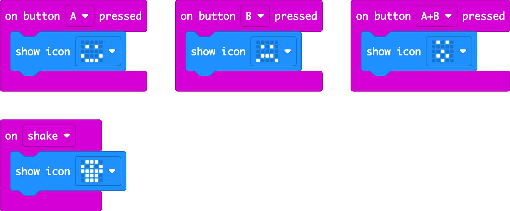
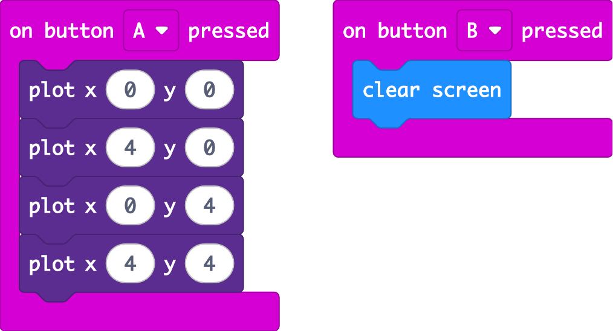
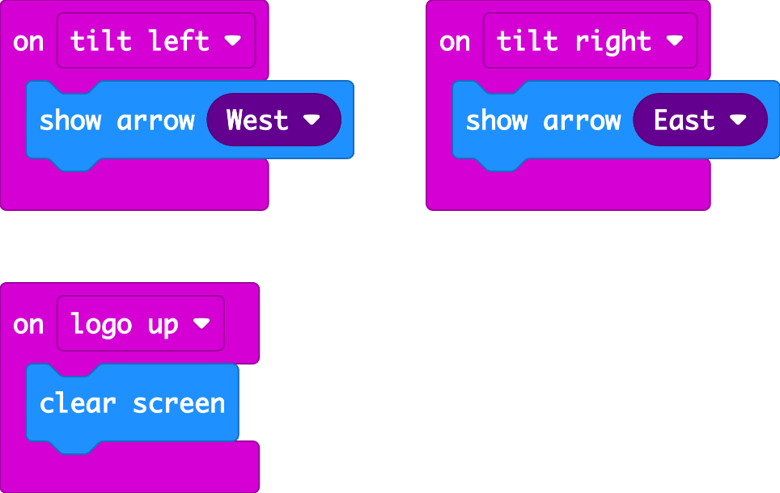

## Exercises

### Exercise 1: Mood display
Make the micro:bit show:
- A happy face when you press **A**
- A sad face when you press **B**
- A surprised face when you press **A+B** together
- A skull when you **shake** it

### Exercise 2: Pixel drawing
Using **plot** from the **Led** section, light up the four corner LEDs when you press **A**, and **clear screen** when you press **B**.

Hint: the corners are (0,0), (4,0), (0,4) and (4,4).

### Exercise 3: Car indicators
Pretend your micro:bit is a car's indicator lights:
- When you **tilt left**, show an arrow pointing **West**
- When you **tilt right**, show an arrow pointing **East**
- When the **logo is up** (micro:bit held upright), clear the screen

Hint: use **on shake** and change "shake" in the dropdown.

 

Solution 1

Solution 2

Solution 3

