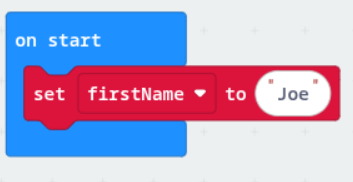
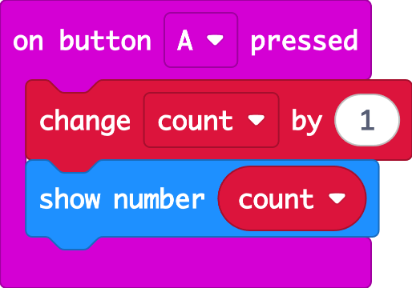

# Variables

Giving the micro:bit a memory

## What is a variable?

A variable is like a storage box with a name written on it. Inside the box, you keep a piece of information. It lets the micro:bit **remember** something and use it, or change it, later.

Think of a game's scoreboard: the **score** starts at 0 and goes up every time someone scores. The score is a variable.

Variables can hold different **types** of information:

| Type | Example | Notes |
|------|---------|-------|
| **Number** | `score = 0` | Can do maths with it |
| **String** (text) | `firstName = "Joe"` | Text goes inside quotation marks `""` |
| **Boolean** | `reverseMode = True` | Only ever `True` or `False` |

This is how a variable called *firstName* looks in MakeCode:

## Variables in MakeCode

Open the **Variables** (red) section and click **Make a Variable...**. Give it a name that describes what it stores, like `score` or `speed`, not `x` or `thing`.

You'll then get these blocks:

| Block | What it does |
|-------|--------------|
| **set score to 0** | Puts a value in the box (replacing what was there) |
| **change score by 1** | Adds to the value. Use `-1` to subtract. |
| **score** (round block) | Reads what's in the box, so you can show it or use it in a decision |

## Example: counter

1. **on start**: set `count` to 0
2. Every time **A** is pressed: add 1 to `count`, then show it

> **Why does the car need variables?** Your car remembers its **radio group**, and your power-up code uses a variable to remember whether a power-up is running. Without variables, the micro:bit would forget everything instantly.
