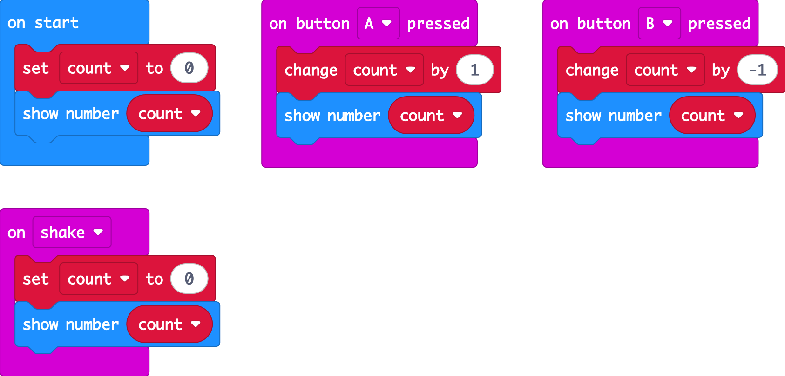
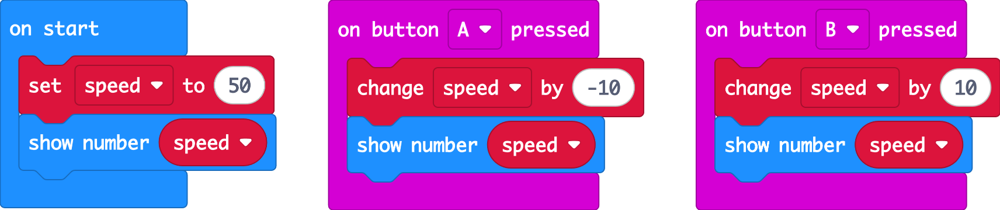
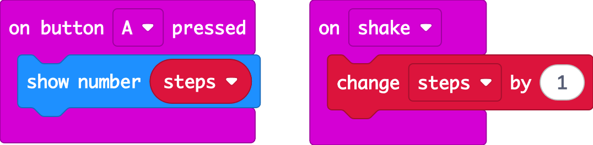

## Exercises

### Exercise 1: Up/down counter
First, make a variable called `count`: open the **Variables** section and click **Make a Variable...**. The **set** and **change** blocks only appear after you've done this.

- **on start**: set a variable `count` to 0 and show it
- **Button A**: count **up** by 1 and show the number
- **Button B**: count **down** by 1 and show the number
- **Shake**: reset back to 0

### Exercise 2: Speed setting
Your car will drive at a speed between **0** and **100**. Make a variable called `speed`:
- It starts at **50**
- **A** lowers it by 10, **B** raises it by 10
- Show the new speed every time it changes

What happens if you press B lots of times? We'll fix that with **if** statements in the next lab!

### Exercise 3: Step counter
Use **on shake** to count your steps. Put the micro:bit in your pocket, walk around the room, then press **A** to see how many steps you took.

 

Solution 1

Solution 2

Solution 3

