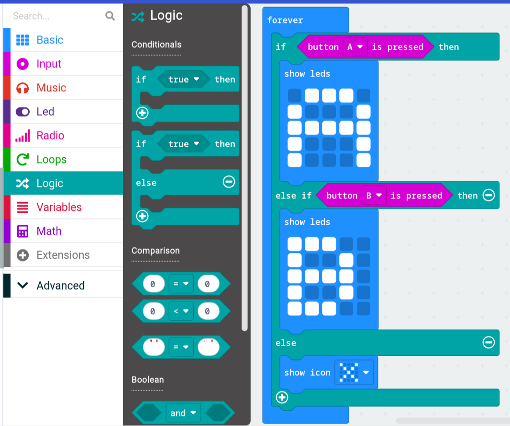

# If & Else

Making decisions

## True or false?

**If** and **else** let the micro:bit make a decision based on whether something is **true** or **false**. (True and false values are a data type called **booleans**.)

You do this all the time without thinking:

```
if it's raining:
    wear a rain coat
else:
    wear a t-shirt
```

BUT what if it's snowing? You can add an **else if**:

```
if it's raining:
    wear a rain coat
else if it's snowing:
    wear a winter coat
else:
    wear a t-shirt     # none of the above were true
```

The micro:bit checks each condition **from top to bottom** and runs the **first** one that's true. Everything below it is skipped.

## In MakeCode

The **if** blocks are in the **Logic** (teal) section. Click the **+** on an if block to add **else if** and **else** sections.

This example shows *A* on the LEDs if button A is pressed, *B* if button B is pressed, and so on:



## Comparisons

A condition is usually a **comparison**. These are in **Logic** too:

| Comparison | Means | Example |
|------------|-------|---------|
| `=` | equal to | `roll = 6` |
| `≠` | not equal to | `message ≠ "stop"` |
| `<` | less than | `temperature < 10` |
| `>` | greater than | `speed > 100` |
| `≤` | less than or equal to | `light level ≤ 50` |
| `≥` | greater than or equal to | `joystick Y ≥ 800` |

## And, or, not

Sometimes one comparison isn't enough. You can combine them:

| Block | True when... | Example |
|-------|--------------|---------|
| **and** | **both** sides are true | it's Saturday **and** it's sunny → go to the beach |
| **or** | **at least one** side is true | it's raining **or** it's snowing → wear a coat |
| **not** | the condition is **false** | **not** button A pressed |

> **Sneak peek at the car:** your joystick remote decides which way to drive using exactly these blocks:
> ```
> if joystick Y ≥ 800:      send "F"   (forward)
> else if joystick Y ≤ 200: send "B"   (backwards)
> else if joystick X ≤ 200: send "L"   (left)
> else if joystick X ≥ 600: send "R"   (right)
> ```
