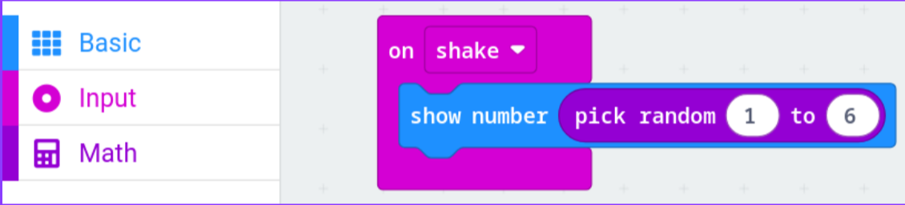

## Exercises

### Exercise 1: Speed limit
Go back to your **speed setting** from the Variables lab. Use **if** so that `speed` can never go below **0** or above **100**.

### Exercise 2: Dice roll
**Warm-up:** when you **shake** the micro:bit, show a random number from 1 to 6.

Hints:
* **pick random** is in the **Math** section
* **on shake** is in the **Input** section

**Level up:** instead of a number, show the dice face using **show leds**. You'll need:
1. A variable `roll`, set to **pick random 1 to 6**
2. An **if / else if** for each number, each with its own **show leds** picture

### Exercise 3: Tilt detector
The micro:bit's accelerometer measures tilt as a number. Find **acceleration (mg) x** in **Input → more**.

1. **Investigate:** in a **forever** block, **show number** for **acceleration x**. Hold the micro:bit flat, then tilt it left and right. Write down roughly what numbers you see.
2. **Build:** using **if / else if / else**:
   - Tilted left → show a **West** arrow
   - Tilted right → show an **East** arrow
   - Flat → show a small square (or clear the screen)

This is the **same logic** your car remote will use with the joystick!

### Exercise 4 (challenge): Night light
**light level** (in **Input**) is a number from 0 (dark) to 255 (bright). Show a moon when it's dark and a sun when it's bright. Test it by covering the LEDs with your hand.

<br>

<details>
<summary>Solution 1</summary>

```javascript
let speed = 50
basic.showNumber(speed)
input.onButtonPressed(Button.A, function () {
    if (speed > 0) {
        speed += -10
    }
    basic.showNumber(speed)
})
input.onButtonPressed(Button.B, function () {
    if (speed < 100) {
        speed += 10
    }
    basic.showNumber(speed)
})
```

</details>

<details>
<summary>Solution 2 (warm-up)</summary>



</details>

<details>
<summary>Solution 2 (level up)</summary>

```javascript
let roll = 0
input.onGesture(Gesture.Shake, function () {
    roll = randint(1, 6)
    if (roll == 1) {
        basic.showLeds(`
            . . . . .
            . . . . .
            . . # . .
            . . . . .
            . . . . .
            `)
    } else if (roll == 2) {
        basic.showLeds(`
            # . . . .
            . . . . .
            . . . . .
            . . . . .
            . . . . #
            `)
    } else if (roll == 3) {
        basic.showLeds(`
            # . . . .
            . . . . .
            . . # . .
            . . . . .
            . . . . #
            `)
    } else if (roll == 4) {
        basic.showLeds(`
            # . . . #
            . . . . .
            . . . . .
            . . . . .
            # . . . #
            `)
    } else if (roll == 5) {
        basic.showLeds(`
            # . . . #
            . . . . .
            . . # . .
            . . . . .
            # . . . #
            `)
    } else {
        basic.showLeds(`
            # . . . #
            . . . . .
            # . . . #
            . . . . .
            # . . . #
            `)
    }
})
```

</details>

<details>
<summary>Solution 3</summary>

Flat is close to **0**, tilting left gives a **negative** number and tilting right gives a **positive** number. A threshold of 300 ignores small wobbles.

```javascript
basic.forever(function () {
    if (input.acceleration(Dimension.X) < -300) {
        basic.showArrow(ArrowNames.West)
    } else if (input.acceleration(Dimension.X) > 300) {
        basic.showArrow(ArrowNames.East)
    } else {
        basic.showIcon(IconNames.SmallSquare)
    }
})
```

</details>

<details>
<summary>Solution 4</summary>

```javascript
basic.forever(function () {
    if (input.lightLevel() < 50) {
        basic.showLeds(`
            . . # # .
            . # # . .
            . # # . .
            . # # . .
            . . # # .
            `)
    } else {
        basic.showLeds(`
            # . # . #
            . # # # .
            # # # # #
            . # # # .
            # . # . #
            `)
    }
})
```

</details>
