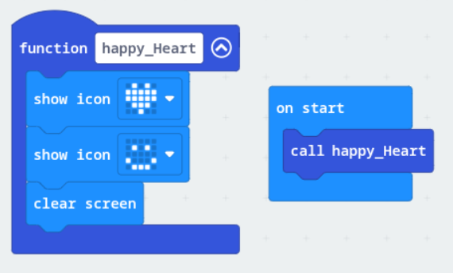
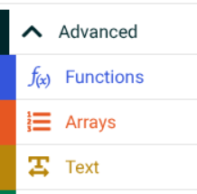

# Functions

## What is a function?

A function is a **saved set of instructions** with a name. Instead of building the same code over and over, you build it once and then **call** it whenever you need it.

The example below is a function called *happy_Heart*. It does three things in order:
[Show heart icon] → [Show smiley face] → [Clear screen].

Every time you **call** this function, all three steps happen automatically.

## Making a function in MakeCode

Functions live under **Advanced → Functions** in the toolbox:

1. Click **Make a Function...** and give it a name that says what it does, like `speedUp` or `celebrate`
2. Put your blocks inside the **function** block
3. Use the **call** block wherever you want it to run

> **Why does the car need functions?** The finished car has functions called `speedUp`, `slowDown` and `banana`, one for each power-up. The main code just says "call speedUp" without needing to know every step inside it. That keeps the code short and easy to read.
