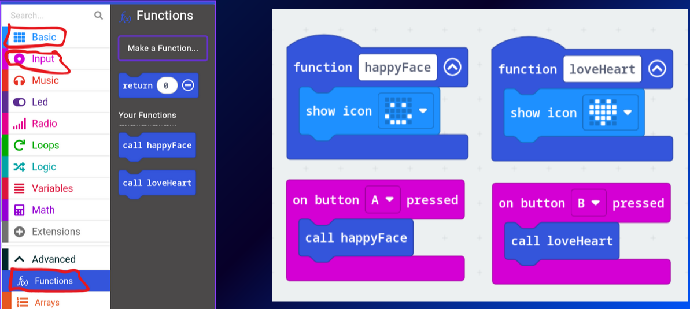
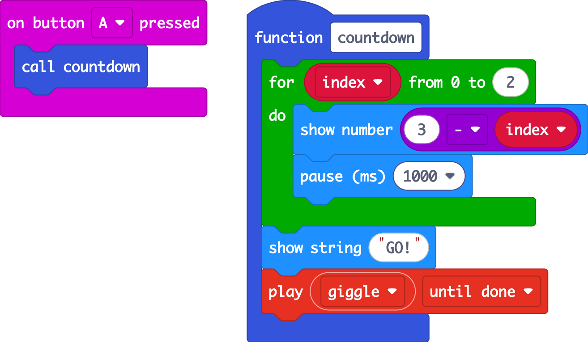
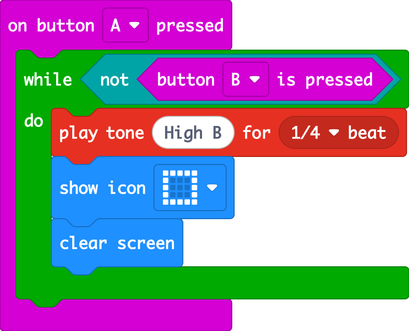

## Exercises

### Exercise 1: Icon functions
Make two functions, each showing a different icon. Call one when you press **A** and the other when you press **B**.

### Exercise 2: Race countdown
Every race needs a start! When you press **A**:
1. Count down **3, 2, 1** on the screen (one second each)
2. Show **"GO!"** (or a big tick icon)
3. *(V2)* Play a sound from the **Music** section

Put your countdown in a **function** called `countdown`. Use a loop if you can!

### Exercise 3: Alarm
Using a **while** loop: while button **B** is **not** pressed, play a tone and flash the screen. Pressing B switches the alarm off.

Hint: **not** is in **Logic**, and **button B is pressed** is in **Input**.

 

Solution 1

Solution 2

**3 − index** gives 3, 2, 1 as **index** counts 0, 1, 2.

Solution 3

Press **A** to start the alarm and hold **B** to stop it.

