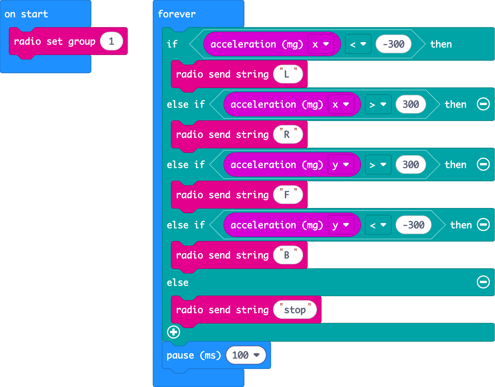
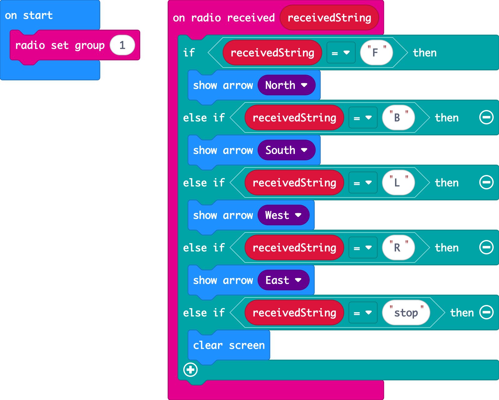

## Exercises

Get into **pairs**. One micro:bit is the **sender** and the other is the **receiver**. Agree on your team's radio group number first!

> **Testing without two micro:bits:** when your code uses radio, MakeCode shows **two** virtual micro:bits. Press buttons on one and watch the other react.

### Exercise 1: Send a message
**Sender**
* In **on start**, set the radio group
* On button **A**, send the string `"hi"`. On button **B**, send the number `7`.

**Receiver**
* In **on start**, set the **same** radio group
* When a string is received, show it on the LEDs
* When a number is received, show it on the LEDs

### Exercise 2: Tilt remote
Build a remote control **without a car** and use the receiver's LEDs to pretend to be the car.

**Sender (the remote):** in a **forever** block, use the tilt logic from the If & Else lab:

| Tilt | Send |
|------|------|
| Left (**acceleration x** < -300) | `"L"` |
| Right (**acceleration x** > 300) | `"R"` |
| Forward (**acceleration y** > 300) | `"F"` |
| Back (**acceleration y** < -300) | `"B"` |
| Flat | `"stop"` |

**Receiver (the pretend car):** **on radio received receivedString**, use **if / else if** to show an arrow for each message (`"F"` → North, `"B"` → South, `"L"` → West, `"R"` → East) and clear the screen for `"stop"`.

Hint: inside the received event, compare **receivedString = "F"** using the **=** block from **Logic**.

If forward and back come out the wrong way round, swap the `<` and `>` for **y**. Testing and fixing is a normal part of coding!

 

Solution 2: Sender

Solution 2: Receiver

Swap the **showArrow** blocks for motor blocks and this **is** your car code. That's the next topic!

