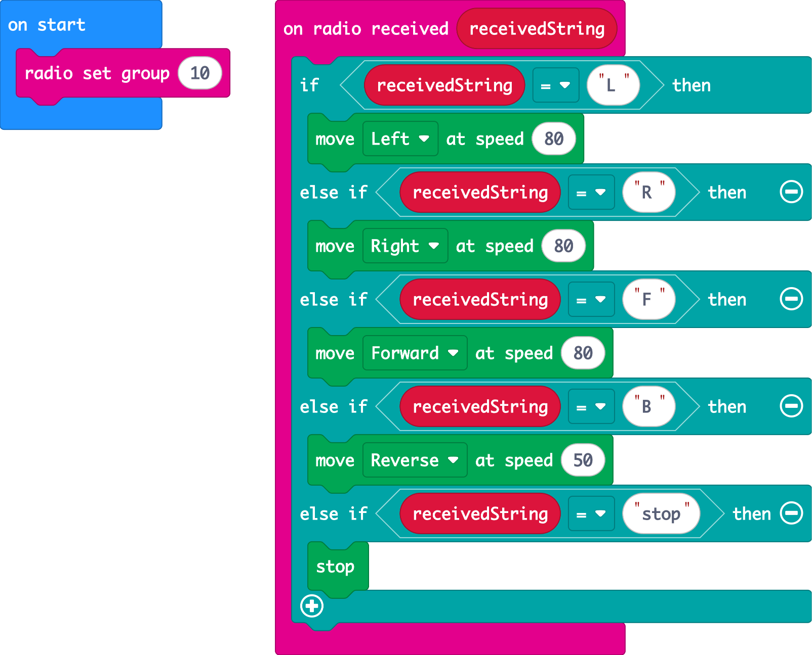

# Coding the Car

## Step 1: On start
* **radio set group** to the **same number as your remote**
* *(Optional)* **show icon** so you know the car is on

## Step 2: Listen for commands

Add an **on radio received receivedString** block from **Radio**. All your driving logic goes inside it.

Using **if / else if**, compare `receivedString` to each command your remote sends:

| If received... | Do this (MOVE Motor section) |
|----------------|------------------------------|
| `"F"` | move **Forward** at speed **80** |
| `"B"` | move **Reverse** at speed **50** |
| `"L"` | move **Left** at speed **80** |
| `"R"` | move **Right** at speed **80** |
| `"stop"` | **stop** |

Check with your teammate: these letters must match **exactly** what the remote sends. `"stop"` and `"Stop"` are different strings!

Feel free to change the speeds (0 to 100). Trial and error is key! Reverse is slower on purpose, because it's harder to control.

## Step 3: Download and drive!

1. Download the code onto the car's micro:bit
2. Switch the car on (and make sure it has batteries!)
3. Switch on your remote and drive

 

Check your work: the finished car

Change the `10` to your team's radio group.

