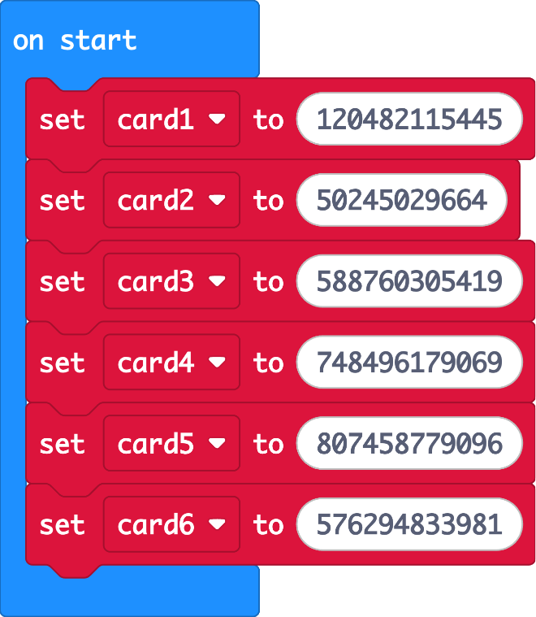
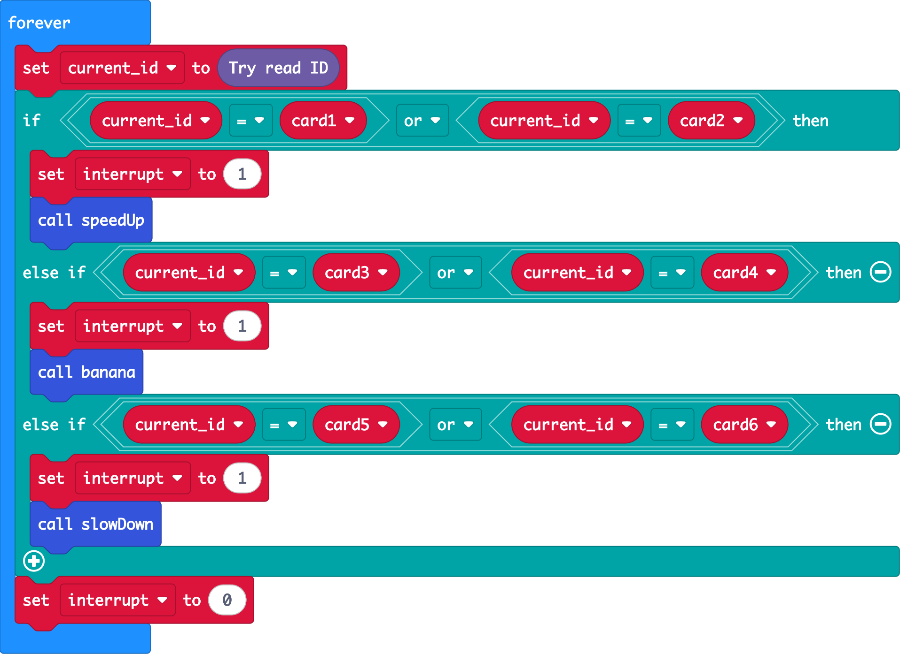
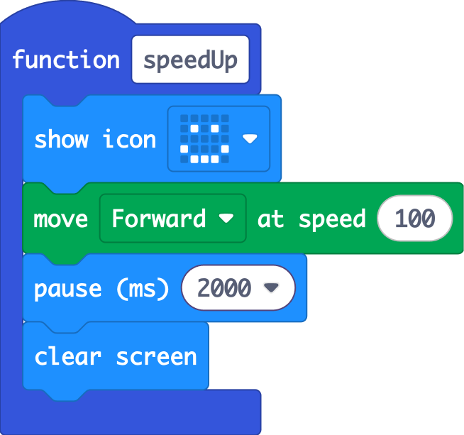
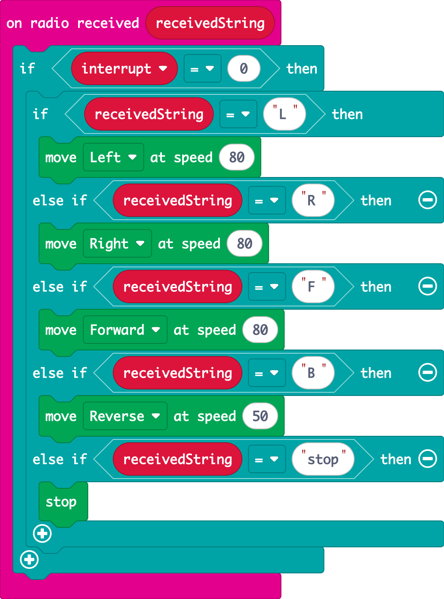

# How it Works

Open the project and find each part below. Notice that it uses **every** coding concept from the Coding Basics topic.

## Variables: remembering the cards

In **on start**, each card's ID number is stored in a variable:

There are two cards for each power-up, so you can hide more of them around the track.

## Loops and if/else: checking for cards

A **forever** loop constantly asks the reader: *"is there a card?"* The ID it finds goes into `current_id` (or `-1` if there's no card). Then **if / else if** decides which power-up to trigger:

The **or** block means *"if it's card 1 **or** card 2, speed up."*

## Functions: one per power-up

Each power-up is its own **function**, so the forever loop stays short and readable:

The **banana** function spins the car by running the left motor **forward** and the right motor **in reverse** at the same time.

## The `interrupt` variable: ignoring the remote

This is the clever part. `interrupt` works like a **flag**:
- `0` means "normal driving, listen to the remote"
- `1` means "a power-up is happening, ignore the remote"

The radio received event checks the flag **before** doing anything:

Without this, your remote would send `"stop"` a split second after you hit a banana and cancel the spin straight away. Programmers use flag variables like this all the time.
